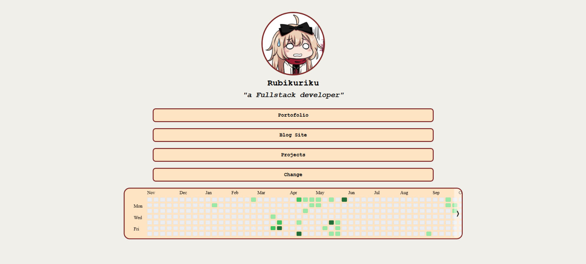

<div align="center">
  
##  Linked - Dynamic Pages

[](https://kyubiner.github.io/Linked/)

</div>

## Description
<div align="justify">

This is my personal website, which features several pages showcasing my skills and identity within the IT field for instance, you can view a list of projects I have developed, ranging from my work as a game developer to my experience as a website developer, and more.

## Background of Project Creation
This project was created out of a desire to establish my presence in the IT world. Given the rapid pace of technological change combined with my own tendency to constantly explore new things it has become difficult for others to clearly identify what I do or what skills I possess. Through this project, I hope that people will come to perceive me in the way that aligns with their own interests; for instance, those with an interest in websites will see that I also enjoy building web based projects, which I showcase by linking to my websites and their content via platforms like Instagram and others.
</div>

## Pages
- Game Developer
- Fullstack Website Developer
- Competitive Programing
- As a member Hack Club

## Feature
- __Random Page Switcher__, can switch pages randomly my identity
- __Centralized IT Identity__, Serves as a single hub connecting to my skill as a Game Developer, Fullstack Web Developer, Competitive Programmer, or as a Hack Club member.

## Tech Stack
- __Html__, Semantic structure & clean layout
- __Javascript__, Dynamic page switching logic & DOM manipulation.
- __Css__, Custom styling and responsive design layout.

## Getting Started
To get a local copy up and running, follow these simple steps:

Clone the repo:
   ```bash
   git clone [https://github.com/kyubiner/Linked.git](https://github.com/kyubiner/Linked.git)
   ```

<div align="center">

My Project Stardance 🌟 Rubikuriku
</div>